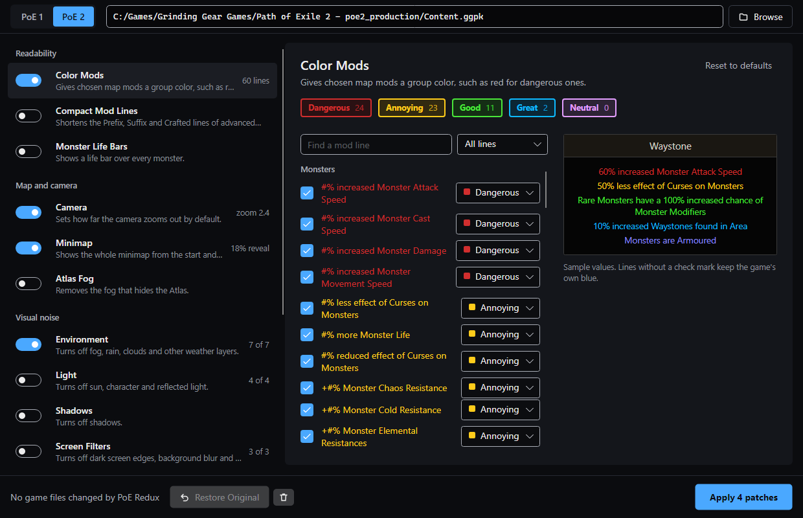

# PoeRedux



PoeRedux edits the files of Path of Exile and Path of Exile 2 to change what the game shows: map mod colors, camera zoom, the minimap, and fog, particles and other visual noise. It keeps the original of every file it changes, and **Restore Original** puts them back.

## Patches

| Patch | What it does | Game |
|---|---|---|
| Color Mods | Gives chosen map and waystone mods a group color: Dangerous, Annoying, Good, Great or Neutral. Group colors can be changed, and each mod line can move to another group or stay uncolored. The list is read from the game's own mod data, so it holds every line a map or waystone can roll. | both |
| Monster Life Bars | Shows a life bar over every monster. | both |
| Camera | Sets the default zoom, from 1.2 to 2.4. | both |
| Minimap | Shows the whole minimap from the start. Its strength and the floor and edge colors can be changed. | both |
| Atlas Fog | Removes the fog that hides the Atlas. | PoE 2 |
| Environment | Turns off fog, screen fog, rain, clouds and other weather layers, each with its own switch. | both |
| Light | Turns off sun and moon light, the light around your character, reflections and bounced light. | both |
| Shadows | Turns off shadows. | both |
| Screen Filters | Turns off dark screen edges, background blur and gray-out. | both |
| Particles, Effects, Microtransactions | Remove particle, skill and shop effects. Boss mechanics, dangerous ground, portals, map devices and waypoints are kept, and the list of kept folders can be changed. | both |
| Corpses | Hides bodies a second after monsters die. | PoE 1 |
| Delirium | Removes the Delirium fog and its ash. | both |
| Loading Screen | Hides the loading screen picture, tip and area name. | both |
| Black Screen | Makes the game screen black. Experimental. | both |

## Installation

1. Go to the [Releases page](https://github.com/Gineticus/PoeRedux/releases).
2. Download the latest `PoeRedux-vX.Y.Z-win-x64.exe`.
3. Run it. It needs no installation and no separate .NET runtime.

## Using it

1. Choose the game, then the game file: `Content.ggpk` in the standalone client's folder, or `Bundles2\_.index.bin` in a Steam or Epic install.
2. Turn on the patches you want. Click a patch to see and change its settings.
3. Click **Apply**. Close the game first.

Apply always starts from the original files: a patch you turn off gets its files back on the next Apply, and changing a setting does not stack on the earlier result. A game update replaces patched files, so apply again after each update.

Settings are saved in `%LOCALAPPDATA%\PoeRedux\settings.json`, and every Apply and Restore writes a log to `%LOCALAPPDATA%\PoeRedux\Logs` that you can attach to a bug report.

## Backups

Before a patch changes a game file for the first time, PoeRedux copies the original into a backup:

```
%LOCALAPPDATA%\PoeRedux\Backups\
    poe1.zip, poe1.2.zip, ...    originals (Path of Exile 1)
    poe1.backup.json             which files PoeRedux changed and what it wrote
    poe2.zip, poe2.2.zip, ...    originals (Path of Exile 2)
    poe2.backup.json
```

**Restore Original** writes the originals back and deletes the backup. If a game update replaced a file after PoeRedux changed it, that file is left as the update made it: its stored original belongs to the old game version.

Do not delete the backup while patches are applied: without it, Restore Original cannot undo them. On Steam, *Properties > Installed Files > Verify integrity of game files* replaces changed files with Steam's copies. `PackCheck.exe` in the standalone client does not: in a test on 18 Nov 2026 it left PoeRedux's changes in place.

## System requirements

- Windows 10 version 2004 or later, or Windows 11.

## Support

For bugs and suggestions, open an issue in the [GitHub repository](https://github.com/Gineticus/PoeRedux/issues).
